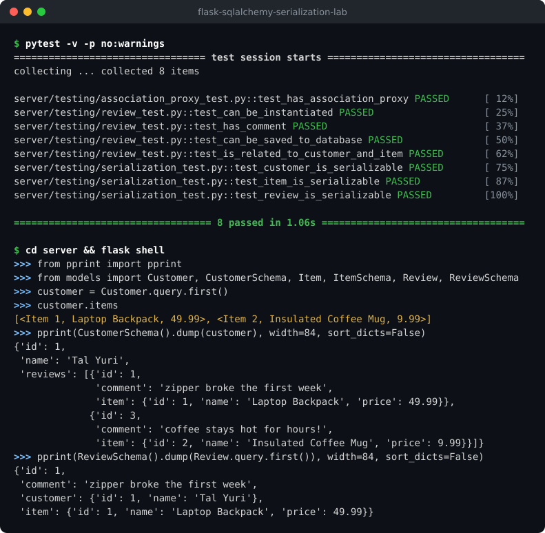

# Flask-SQLAlchemy Serialization Lab

A small Flask and SQLAlchemy example showing how customers, products, and
product reviews fit together. It also demonstrates how Marshmallow can turn
related model objects into JSON-friendly dictionaries without recursively
serializing the same relationships forever.

## What it does

- Stores customers and items in separate database tables.
- Stores each review with a comment and links to its customer and item.
- Lets you access a customer's reviewed items with `customer.items`.
- Serializes customer, item, and review objects with Marshmallow schemas.
- Includes sample records for trying the models locally.

## Screenshot

The full test suite passing, followed by the association proxy and serialized
output from the seeded database in a Flask shell:



## Data model

Each review belongs to one customer and one item. Customers and items can each
have many reviews. The association proxy lets a customer access the items from
those reviews directly.


## Setup

The project uses Python 3.8.13 and Pipenv. From the repository root, install the
dependencies:

```console
pipenv install
pipenv shell
```

Then create and upgrade the database from the `server` directory:

```console
cd server
flask db init
flask db migrate -m "create customer, item, and review tables"
flask db upgrade
```

To populate the database with the sample customers, items, and reviews:

```console
python seed.py
```

The seed script clears existing rows before adding its sample data, so it can be
run again to restore the same dataset.

## Try the models

From `server`, open a Flask shell:

```console
flask shell
```

Then inspect a customer's reviewed items and serialize some models:

```python
from models import Customer, CustomerSchema, Item, ItemSchema, Review, ReviewSchema

customer = Customer.query.first()
customer.items

CustomerSchema().dump(customer)
ItemSchema().dump(Item.query.first())
ReviewSchema().dump(Review.query.first())
```

The customer and item schemas include their reviews. Each nested review omits
the parent object to prevent circular output. A review's nested customer and
item omit their own reviews for the same reason. Foreign-key columns are kept
out of the serialized output because the related objects provide that context.

## Run the tests

From the repository root, run the full test suite:

```console
pytest
```

Or run an individual group:

```console
pytest server/testing/review_test.py
pytest server/testing/association_proxy_test.py
pytest server/testing/serialization_test.py
```

The test fixture runs against `server/instance/app.db` and drops its tables
when it finishes. After running the tests, rebuild and reseed the development
database from `server`:

```console
flask db stamp base
flask db upgrade
python seed.py
```

## Project layout

- `server/models.py` defines the database models, association proxy, and schemas.
- `server/app.py` configures the Flask application and database.
- `server/seed.py` creates sample customers, items, and reviews.
- `server/testing/` contains tests for the models and serialization behavior.
